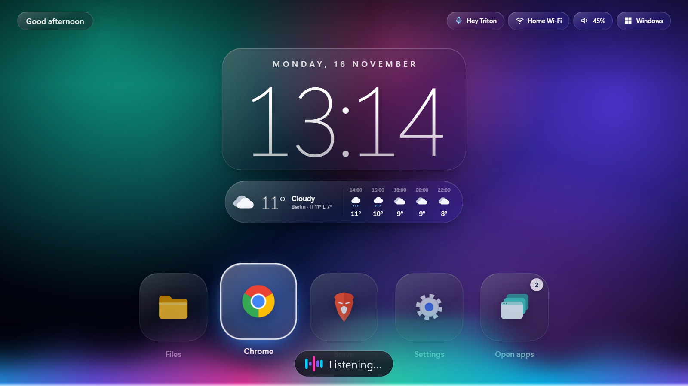
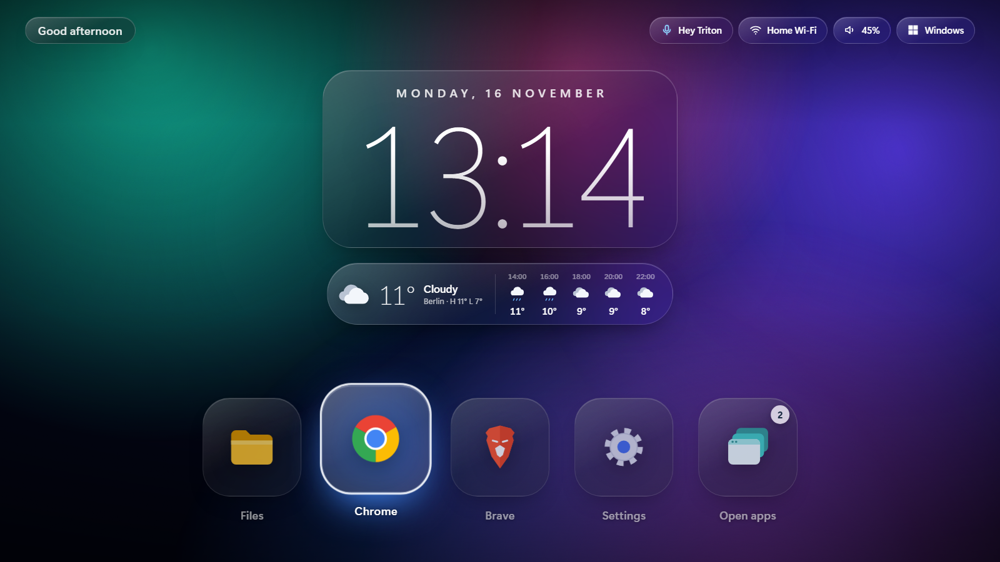
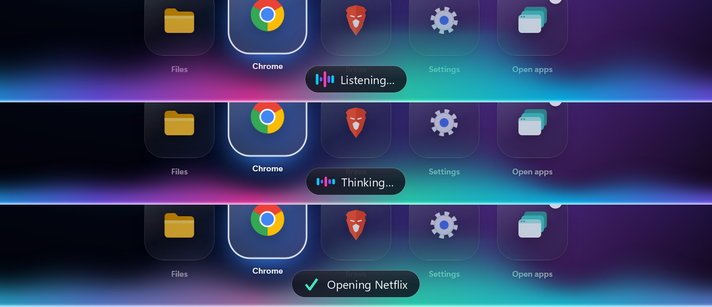

# Triton

Triton turns a small Windows PC under the TV (an Intel N95 mini PC) into a living-room computer you run by voice:
a fullscreen home screen, a **"Hey Triton"** voice assistant that works offline, and low-latency screen sharing
from a laptop to the TV.

| Part | Folder | What it is |
|---|---|---|
| **Triton Launcher** | [`Triton Launcher/`](Triton%20Launcher/) | Fullscreen home screen: clock, weather, wallpapers, big app tiles, Wi-Fi/volume/power menus. C# (.NET Framework 4.8) + Edge WebView2. Starts the other two. |
| **Triton Voice** | [`Voice Assistant/`](Voice%20Assistant/) | The "Hey Triton" assistant: wake word, speech-to-text, a fine-tuned 0.6B model that turns sentences into actions, a spoken reply. Python, packaged as `TritonVoice.exe`. |
| **Triton Screen Share** | [`Triton Screen Share/`](Triton%20Screen%20Share/) | Shows a laptop's screen on the TV with a few milliseconds of delay, with mouse and keyboard sent back and the laptop's camera and mic available on the TV PC. C++ and GStreamer. |

## Triton Launcher

A lightweight home screen for a TV PC, built on what Windows already has (.NET Framework 4.8 and WebView2), so
there is nothing to install. It can replace the Windows desktop entirely ("TV mode"), keeps Wi-Fi, volume and power
one click away, and starts and stops the voice assistant and screen sharing with it. Details, install and settings:
[`Triton Launcher/README.txt`](Triton%20Launcher/README.txt).

## Triton Voice

Say **"Hey Triton"**, then a command in your own words: *"open Netflix and select the first profile"*, *"turn it
down a bit"*, *"search YouTube for lofi"*, *"why is the sky blue?"*. Everything runs on the PC itself:

- **Wake word:** openWakeWord, trained on your own voice, plus a personal voice check.
- **Ears:** Moonshine streaming speech-to-text (Whisper as a second opinion) and Vosk for instant command words,
  with echo cancellation (WebRTC AEC3) so the TV's sound isn't heard as commands.
- **Brain:** fixed rules first, then Triton-Mini (a Qwen3-0.6B fine-tuned for this, run by llama.cpp), then
  optionally a bigger model on the laptop, or the Max assistant for questions.
- **Hands:** opens apps, clicks what's on screen (UI Automation), types, controls media, volume, the monitor and
  screen sharing, with a safety check before anything risky.
- **Voice:** Piper text-to-speech, plus the on-screen bubble:

### Listening like Max (November 2026)

Triton used to work in separate steps: listen, stop, think, answer, then start listening again from scratch.
It now listens the whole time, like the Max assistant:

- **Nothing is thrown away.** The mic goes into a shared buffer (`audio_hub.py`) that every part reads at its own
  pace, so what you say while Triton thinks or talks is kept.
- **It notices sooner that you've finished.** End of sentence after 0.65 s of silence (was 0.8 s), and 0.4 s when
  the words already make a whole command. On 26 recorded commands: median 0.68 s → 0.56 s, no sentence cut short.
- **It thinks while still listening.** If you carry on after a pause ("open Netflix … and select the first
  profile"), the first guess is dropped and the whole sentence is understood.
- **You can talk over it.** In a conversation, start talking while Triton answers and it stops and listens
  (needs echo cancellation; `"barge_in": "off"` in `settings.json` turns it off).
- **Fewer false wake-ups.** The wake word must contain real speech, it's stricter while Triton itself is talking,
  and a wake-up with nothing said after it ends silently instead of "Sorry, could you say that again?".

The whole design, the models we picked and their measurements: [`Voice Assistant/README.md`](Voice%20Assistant/README.md)
and [`Voice Assistant/ARCHITECTURE.md`](Voice%20Assistant/ARCHITECTURE.md).

## Triton Screen Share

A low-latency alternative to Miracast. One app with two modes, **Share this screen** and **Show a screen here**:
GPU capture and Quick Sync H.264 on the sender, decoding straight to the display on the receiver, an adaptive bitrate
that stays live on a slow Wi-Fi link, encrypted pairing, an "extend" virtual display, and the laptop's camera and mic
on the TV PC ("Triton Camera", VB-Cable). Details: [`Triton Screen Share/README.md`](Triton%20Screen%20Share/README.md).

## Building

| Part | Command | Output |
|---|---|---|
| Screen Share | `Triton Screen Share\build.bat` | `Triton Screen Share\dist\` |
| Voice (packaged) | `Triton Launcher\build-voice.ps1` | `Triton Launcher\voice-build\TritonVoice\TritonVoice.exe` |
| Everything for the TV PC | `Triton Launcher\build.ps1` (`-RebuildVoice` after changing the voice code) | `Triton Launcher\dist\TritonLauncher\` + zip |

Run the voice assistant from source on a laptop with `Voice Assistant\Start Triton.bat` (a Python 3.13 venv from
`requirements.txt`). Tests: `.venv\Scripts\python.exe tests\test_listening.py` and `tests\test_max_brain.py`.

## Not in this repository

Kept out on purpose (see [`.gitignore`](.gitignore)):

- **Models** (`Voice Assistant/models/`, about 0.8 GB, and training output): downloaded or trained, see the voice README.
- **Settings with secrets:** `Voice Assistant/settings.json` and `big_brain.json` hold the key for the laptop's big
  brain; each device has its own.
- **Personal recordings and logs:** voice samples, saved commands, `assistant.log`, conversations.
- **Builds and downloads:** `dist/`, `voice-build/`, `build/`, VB-Cable.
